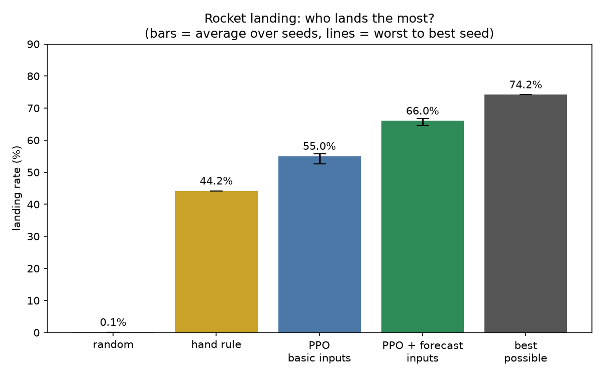
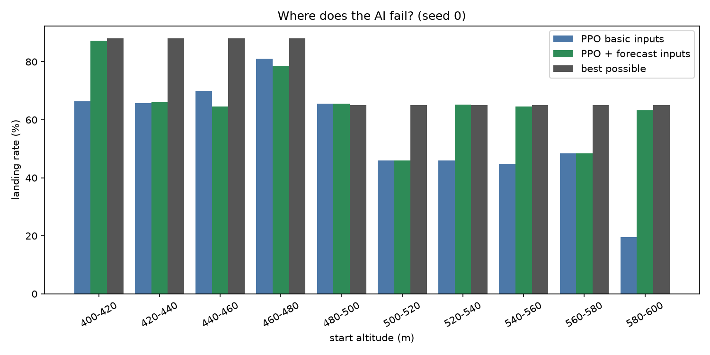
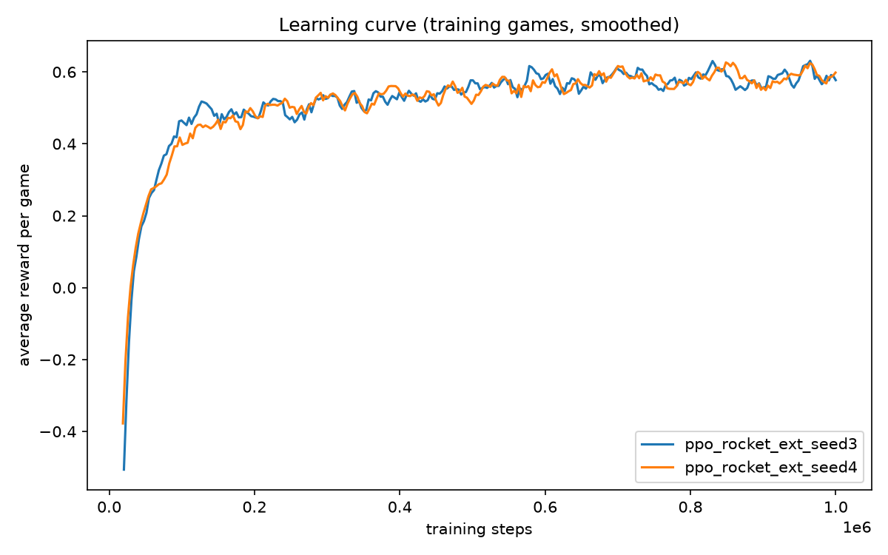

# Rocket Landing with PPO

A small reinforcement-learning experiment: train an agent to land a rocket safely using a custom [Gymnasium](https://gymnasium.farama.org/) environment and [PPO](https://stable-baselines3.readthedocs.io/en/master/modules/ppo.html) from Stable-Baselines3.

The rocket starts between 400 m and 600 m above the ground. At each second the agent either coasts or burns fuel. A landing is successful when the impact speed is at most **10 m/s**.

## What is in the project?

- `rocket.py` — discrete rocket physics, manual play mode, and simple hand-written controllers.
- `rocket_env.py` — Gymnasium environment exposed to the learning agent.
- `train.py` — trains PPO agents for the configured random seeds.
- `evaluate.py` — measures landing rate for saved agents.
- `analysis.py` / `ceiling.py` — compare learned behavior with the best theoretically achievable landing range.
- `baselines.py` and `random_agent.py` — non-learning baselines.
- `plots.py` — creates charts from evaluation and training-log data.
- `test_env.py` — validates the Gymnasium environment contract.

The environment has two observation modes:

- **Basic**: altitude, vertical speed, and remaining fuel.
- **Extended**: the basic state plus two one-step forecasts (coast now vs. burn now), helping the agent reason about the likely impact.

## Results

The checked-in figures summarize the current experiment results. They compare random and hand-written policies with PPO agents, show how landing success varies by starting altitude, and plot the learning curves from recorded training runs.

### Landing-rate comparison



### Performance by starting altitude



### Training learning curves



Run `python plots.py` after updating evaluation data to regenerate these figures.

## Setup

Python 3.10+ is recommended.

```bash
python -m venv .venv
```

Activate the environment:

```powershell
.venv\Scripts\Activate.ps1
```

```bash
python -m pip install --upgrade pip
python -m pip install gymnasium numpy stable-baselines3 matplotlib
```

## Run it

Validate the environment first:

```bash
python test_env.py
```

Train the configured PPO runs (by default, extended observations and seeds 3–4):

```bash
python train.py
```

This creates `ppo_rocket_ext_seed*.zip` model files and monitor logs under `logs/`. They are intentionally ignored by Git because they can be regenerated.

Evaluate saved models:

```bash
python evaluate.py
```

Inspect failure patterns or calculate the theoretical ceiling:

```bash
python analysis.py
python ceiling.py
```

Generate report charts after training:

```bash
python plots.py
```

## Configuration

`train.py`, `evaluate.py`, and `analysis.py` each contain an `EXTENDED` flag. Keep it consistent with the model files being loaded:

- `False` loads/trains `ppo_rocket_seed*.zip` models with 3 observations.
- `True` loads/trains `ppo_rocket_ext_seed*.zip` models with 7 observations.

You can also adjust `SEEDS` and `STEPS` in `train.py` to control experiment size.

## Reproducibility notes

Training scripts set an explicit seed per run, and the environment samples starting altitude through Gymnasium's seeded random-number generator. PPO training can still vary slightly across library or hardware versions, so record the dependency versions alongside any reported result.

## License

No license has been selected yet. Add one before distributing or accepting outside contributions.
